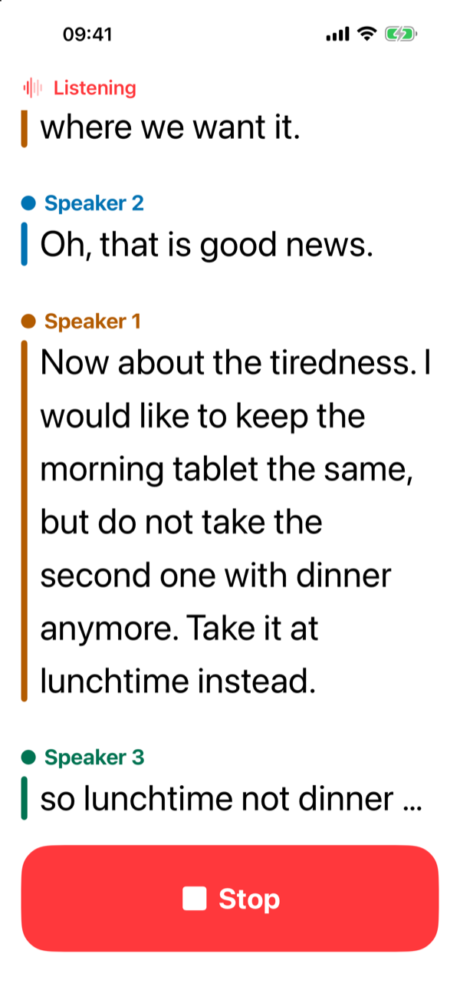
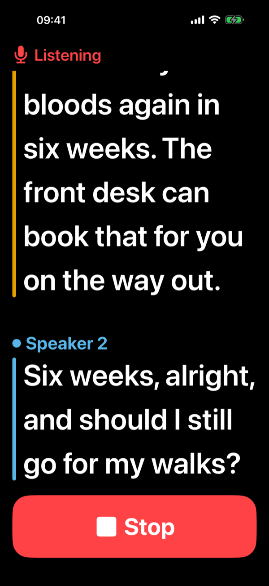
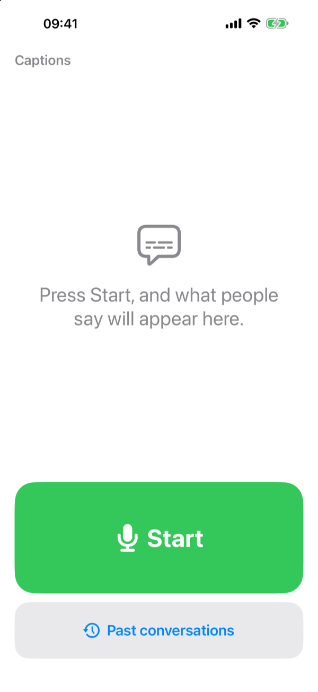
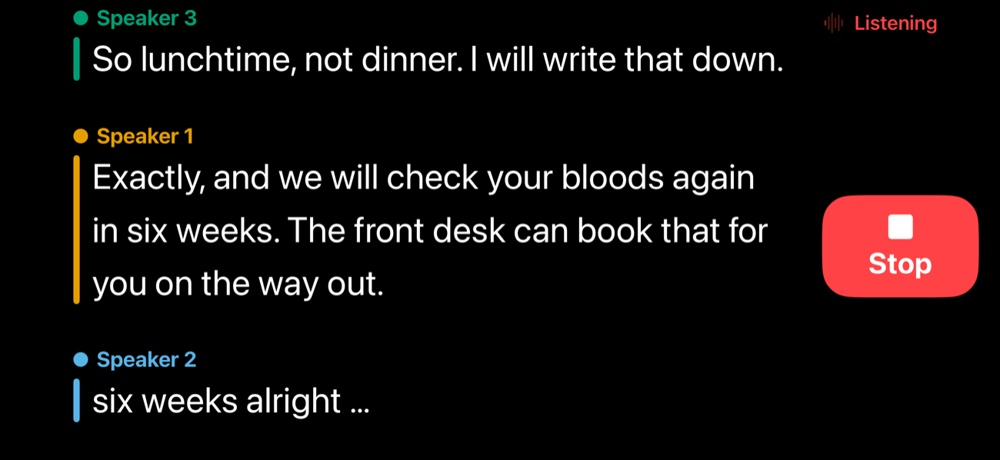
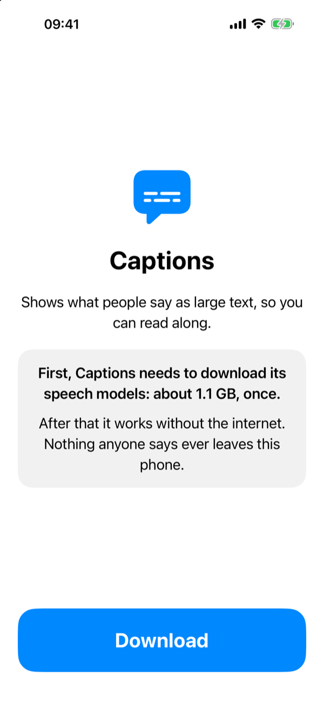
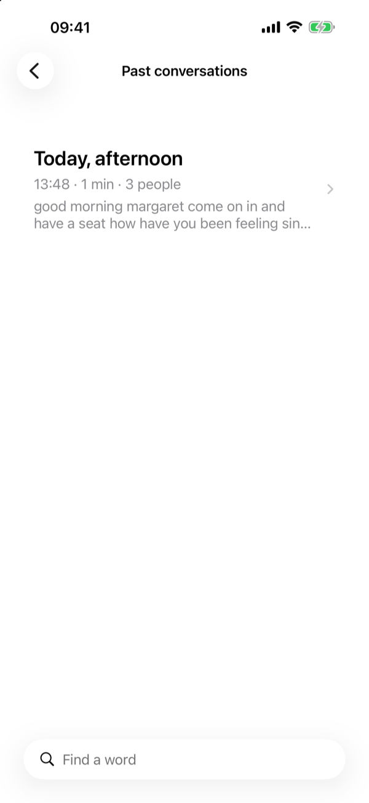
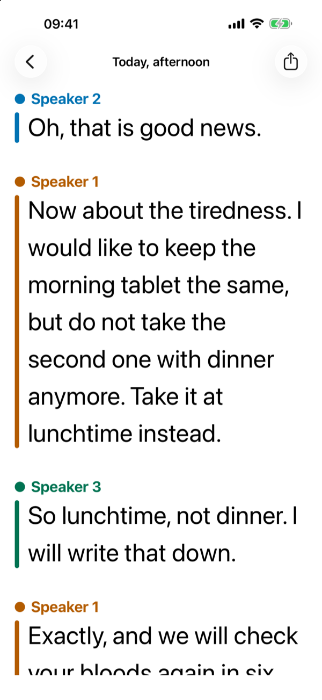
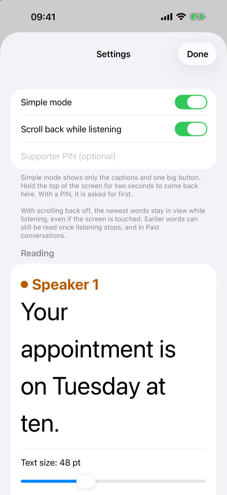

# Open Captions

Live captions for conversations, on an iPhone, for people who find it hard to hear. Press the
big button and what people around you say appears on the screen as large, clear text. Each
speaker gets their own colour.

Everything runs on the phone. No audio or text is sent anywhere, there is no account, and the
app keeps working without an internet connection once it is set up.

<p align="center">
  
  
  
</p>
<p align="center">
  
</p>

## Who it is for

Open Captions is built for someone who is hard of hearing and does not want to fiddle with an
app. Think of an older relative at the dinner table, at a doctor's appointment or on a video call.

- **One screen, one button.** Simple mode shows only the captions and a large Start/Stop button.
  It is on by default.
- **Settings are for the helper.** A family member or carer sets the app up. To reach the settings,
  hold a finger on the top of the screen for two seconds. You can also protect them with a PIN.
- **Built for Assistive Access.** The app has its own simplified screen for iOS's Assistive Access
  mode.

## What it does

- **Large captions that keep up.** The newest words stay in view. Scroll back to re-read
  something, then tap **Back to now** to return.
- **Who said what.** A coloured bar and a name mark each change of speaker. You can rename
  "Speaker 1" to the person's real name. The colours are chosen to stay distinct for people with
  common kinds of colour blindness.
- **Punctuation and paragraphs.** Captions get full stops, commas and capitals. When one person
  talks for a long time, their speech is broken into paragraphs at the ends of sentences.
- **Easy to read.** You can change the text size (24 to 96 pt), the letters (standard, rounded or
  serif), bold text, line spacing, and light, dark or high-contrast colours. The app also follows
  the phone's own text-size setting.
- **Works on its side.** Turn the phone sideways and the captions get most of the screen.
- **Past conversations.** Saved conversations can be read later. You choose how long they are
  kept, from a week to until you delete them. Audio is never stored.
- **Keeps listening with the screen locked**, and can keep the screen awake while it listens.

### More screens

| First run | Past conversations | A saved conversation | Settings |
|---|---|---|---|
|  |  |  |  |

The screenshots are from the iOS Simulator, playing back a scripted conversation.

## Requirements

- An iPhone with iOS 26 or later. iPad works too.
- About 1.1 GB of free space for the speech models. They download once, when the app is first set
  up. The alternative Parakeet Unified model in settings is about 3.3 GB.
- The first start after setup takes about 20 seconds while the phone prepares the models. After
  that, captions start straight away.

## How well it works

Captions appear about a second behind the speaker. Open Captions works well in a quiet room with
one or two people. It is less good across a noisy restaurant table or with several people talking
over each other, as every captioning system is. Treat the captions as a help, not a record. Don't
rely on them alone for anything important, such as medicine doses or emergency instructions.

The measurements behind these choices are in [docs/ENGINES.md](docs/ENGINES.md) and
[docs/RESEARCH.md](docs/RESEARCH.md).

## Models

Every model is open and runs on the phone. The speech models are NVIDIA's, converted to Core ML
by FluidInference and run through [FluidAudio](https://github.com/FluidInference/FluidAudio).

| What it does | Model | Core ML version the app downloads | Licence |
|---|---|---|---|
| **Turns speech into words** (default) | [nvidia/nemotron-speech-streaming-en-0.6b](https://huggingface.co/nvidia/nemotron-speech-streaming-en-0.6b) | [FluidInference/nemotron-speech-streaming-en-0.6b-coreml](https://huggingface.co/FluidInference/nemotron-speech-streaming-en-0.6b-coreml) (`1120ms`) | [NVIDIA Open Model License](https://www.nvidia.com/en-us/agreements/enterprise-software/nvidia-open-model-license/) |
| **Tells speakers apart** | [nvidia/diar_streaming_sortformer_4spk-v2.1](https://huggingface.co/nvidia/diar_streaming_sortformer_4spk-v2.1) | [FluidInference/diar-streaming-sortformer-coreml](https://huggingface.co/FluidInference/diar-streaming-sortformer-coreml) | [NVIDIA Open Model License](https://www.nvidia.com/en-us/agreements/enterprise-software/nvidia-open-model-license/) |
| **Turns speech into words** (alternative, in settings) | [nvidia/parakeet-unified-en-0.6b](https://huggingface.co/nvidia/parakeet-unified-en-0.6b) | [FluidInference/parakeet-unified-en-0.6b-coreml](https://huggingface.co/FluidInference/parakeet-unified-en-0.6b-coreml) | [CC BY 4.0](https://creativecommons.org/licenses/by/4.0/) |
| **Adds punctuation, capitals and sentence ends** | [1-800-BAD-CODE/punct_cap_seg_en](https://huggingface.co/1-800-BAD-CODE/punct_cap_seg_en) | Built into the app, converted by [Scripts/punctuation_model.py](Scripts/punctuation_model.py) | [Apache 2.0](https://www.apache.org/licenses/LICENSE-2.0) |

## Install

- Download the latest `.ipa` from the [Releases page](https://github.com/nlwstein/open-captions/releases).
- It is unsigned. Install it with a sideloading tool such as [AltStore](https://altstore.io),
  [SideStore](https://sidestore.io) or [Sideloadly](https://sideloadly.io), which signs it with
  your own Apple ID.
- It needs iOS 26 or later. The speech models (about 1.1 GB) download when the app is first set up.

## Building it yourself

Open Captions isn't on the App Store yet. To put it on your own phone you need a Mac with:

- Xcode 26
- [XcodeGen](https://github.com/yonaskolb/XcodeGen) (`brew install xcodegen`)
- [uv](https://docs.astral.sh/uv/), which builds the punctuation model the first time

Then:

```bash
Scripts/sim.sh build && Scripts/sim.sh install && Scripts/sim.sh run   # in the iOS Simulator
Scripts/device.sh run                                                  # on a connected iPhone
```

The first build converts the punctuation model, which takes a minute or two. Installing on a real
iPhone needs your own Apple developer signing team in Xcode.

To run the library tests on the Mac, use `swift test`. The measurement harness, which scores
speech engines against recorded conversations, is described in [docs/RESEARCH.md](docs/RESEARCH.md).

## Privacy

- **No audio leaves the phone.** Speech is turned into text on the device.
- **Audio is never saved.** Only the text of a conversation is kept, on the phone, for as long as
  the settings say.
- **The internet is used once,** to download the speech models from Hugging Face. Nothing is
  uploaded.

## Licence

Open Captions is free to use, change and share for any noncommercial purpose, under the
[PolyForm Noncommercial License 1.0.0](LICENSE). You may not sell it or make money from it.
The models and libraries it uses keep their own licences, listed in
[THIRD_PARTY_NOTICES.md](THIRD_PARTY_NOTICES.md).

## Credits

Open Captions is built on open models and libraries, including NVIDIA's speech models,
[FluidAudio](https://github.com/FluidInference/FluidAudio) and
[ChatLayout](https://github.com/ekazaev/ChatLayout). Each one and its licence is listed in
[THIRD_PARTY_NOTICES.md](THIRD_PARTY_NOTICES.md).
